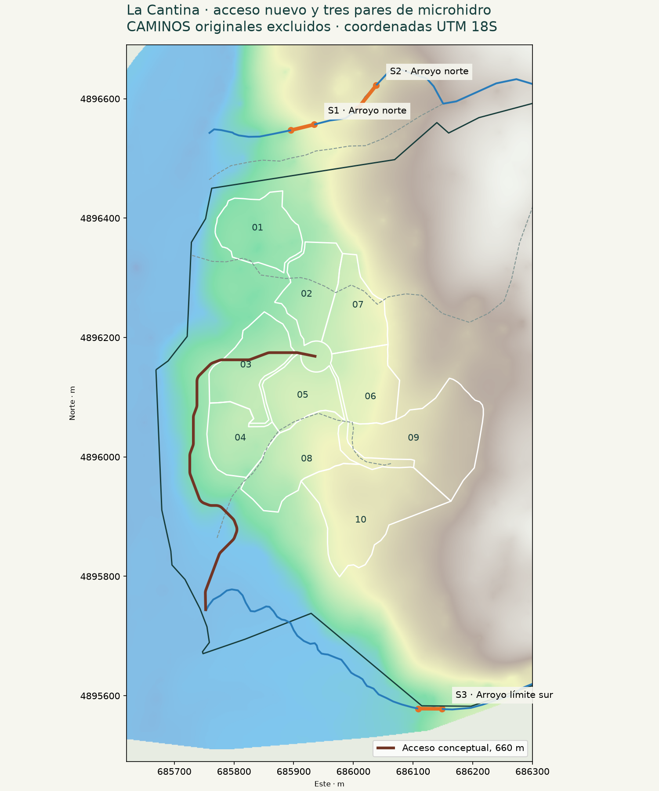
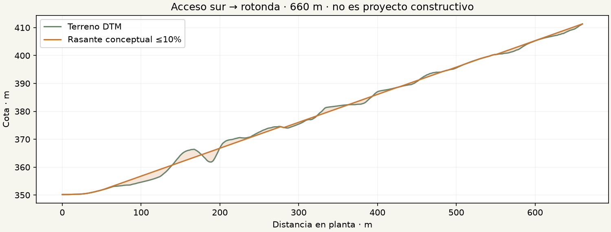

# La Cantina · acceso nuevo y microhidro para verano

Revisión 3 · 19 de octubre de 2026. Propuesta conceptual con herramientas gratuitas. [Visor público](https://la-cantina-hidro.craftysmile14.chatgpt.site) · [Repositorio](https://github.com/fglade/la-cantina-hidro).

**Propuesta eléctrica: 1 kW continuo, batería nominal de 5,12 kWh e inversor de 3 kW compartidos para 2–3 casas de consumo básico durante unos 60 días de verano.** Primera alternativa a aforar: **S1, arroyo norte**, con unos 48,7 m de tubería. El alimentador a rotonda eleva el costo: energía S1 **$12,0–22,8 millones CLP**, con 25% de contingencia y sin camino ni servidumbres/tasas específicas.

**El acceso vial es otra escala de inversión.** Se propone un corredor nuevo de **660 m**, desde la desembocadura del arroyo del límite sur hasta la rotonda inferida del loteo. Rasante de cálculo ≤10%, pero con movimiento de tierras y afectación de lotes. Presupuesto de orden de magnitud: **$116,6–225,6 millones**, con 30% de contingencia. No es un límite superior ni una cotización. S1 + camino: **$128,6–248,4 millones** bajo estos alcances. No corresponde presentar todo como una instalación barata y sin maquinaria.

## Alcance y cambio de criterio

Se excluye por completo la geometría CAMINOS entregada como apoyo de trazado, costo o evidencia de obra existente. Sólo se usan los diez polígonos numerados para el loteo. Los archivos originales se preservan por trazabilidad. La rotonda se localiza ajustando un círculo a 60 vértices de arcos de linderos de lotes: radio inferido 25,98 m; no se usa el polígono CAMINOS.

Se mantienen completos los seis cauces y las 512 curvas, incluidos el arroyo norte y la topografía exterior al deslinde. Arroyos permanentes según el propietario: prioridad 1. Quebradas no permanentes: última prioridad; el propietario indica que habría que perforar para alcanzar el agua. No se les atribuye generación firme ni se propone perforar para esta microcentral.

El [apéndice de potencial amplio](APENDICE_POTENCIAL.md) conserva los escenarios originales de 10/25/50/100 L/s, recalculados sin preferencia por caminos hipotéticos. Esa selección de mayor salto no es el proyecto pequeño recomendado aquí.

## Demanda y tamaño sugerido

Supuesto de trabajo, no inventario de aparatos: 1,5–3 kWh/casa/día para iluminación LED, refrigeración eficiente, comunicaciones y equipos pequeños. Tres casas: 4,5–9 kWh/día. Sin calefacción eléctrica, termo, cocina eléctrica ni carga de vehículos. La ubicación y simultaneidad de las casas aún no se conocen.

| Generación continua | Energía bruta diaria | Útil diaria supuesta | Útil en 30 días | Útil en 60 días |
|---:|---:|---:|---:|---:|
| 0,5 kW | 12 kWh | 8,64 kWh | 259,2 kWh | 518,4 kWh |
| 1,0 kW | 24 kWh | 17,28 kWh | 518,4 kWh | 1.036,8 kWh |

Útil = P × horas × 0,80 disponibilidad × 0,90 almacenamiento/distribución, ambos supuestos. No es una predicción de caudal de verano. No sumar otra vez esos descuentos al comparar con la demanda. 0,5 kW puede quedar justo para tres casas; 1 kW da margen para cargas moderadas y recarga. No se garantiza la demanda sin medir caudal y levantar consumos.

Batería LiFePO4: 5,12 kWh nominales, unos 3,69 kWh útiles adoptando 80% de descarga y 90% de entrega; no ofrece un día entero a la demanda superior. Inversor senoidal de 3 kW **compartidos**, no por casa. Su potencia debe confirmarse con arranque de refrigeradores y gestión de simultaneidad. No transportar 1 kW a 48 V por cientos de metros: la arquitectura de generación, regulación y transporte debe definirla el proyectista eléctrico.

## Tres pares prioritarios para aforo y visita

Todos dimensionados aquí a **1 kW eléctrico** con η global 0,65. Son tres alternativas, no tres instalaciones acumulativas.

| Par / cauce | Hb m | Tubería 3D m | Hn m | Q útil L/s | HDPE exterior / interior mm | Tubería exterior al deslinde, planta m |
|---|---:|---:|---:|---:|---:|---:|
| S1 · Arroyo norte | 26,1 | 48,7 | 24,3 | 6,46 | 90 / 73,6 | 40,0 |
| S2 · Arroyo norte | 19,7 | 54,0 | 18,4 | 8,54 | 110 / 90,0 | 49,8 |
| S3 · Arroyo límite sur | 21,6 | 46,8 | 20,7 | 7,58 | 110 / 90,0 | 39,7 |

**S1:** primer candidato por menor salto, tubo corto y menor provisión de cable que las otras alternativas seleccionadas. **S2:** reserva en el norte, menor salto y más caudal necesario. **S3:** comparación en el arroyo sur; mayor distancia eléctrica estimada a la rotonda. El ranking usa longitudes de tubo/cable, presión y exterioridad; no demuestra óptimo global ni acceso fácil para construir. La accesibilidad de obras y costos de servidumbre no están acreditados.

**Los tres pares están fuera del deslinde original.** Estudiar el arroyo norte no concede acceso ni uso del terreno. No comprar equipos antes de comprobar acceso/tenencia y caudal derivable en verano después de reservas y otros usos.

| Par | Referencia | Latitud | Longitud | Cota terreno m |
|---|---|---:|---:|---:|
| S1 | Bocatoma | -46.0592790 | -72.5961557 | 432,5 |
| S1 | Turbina/restitución | -46.0593757 | -72.5966535 | 406,4 |
| S2 | Bocatoma | -46.0586586 | -72.5948386 | 455,6 |
| S2 | Turbina/restitución | -46.0590179 | -72.5952235 | 436,0 |
| S3 | Bocatoma | -46.0680220 | -72.5930110 | 395,5 |
| S3 | Turbina/restitución | -46.0680297 | -72.5935243 | 373,9 |

Coordenadas EPSG:4326; distancias calculadas en EPSG:32718. Los puntos son referencias sobre el cauce, no emplazamientos constructivos. Ubicar la sala en una margen segura frente a crecidas y verificar restitución. El DTM proporciona cotas de terreno, no niveles del agua; el datum vertical y alineación del cauce necesitan comprobación. El salto real puede variar.

## Hidráulica compacta para S1

Captación con rejilla, desarenado y venteo/cabezal que mantenga la tubería llena; sin canal de aducción ni cámara separada en esta propuesta compacta. Incorporar anclajes, cierre controlado y restitución; no modelar un azud importante como si fuera una simple manguera.

Hb = 432,53 − 406,39 = **26,14 m**. Con HDPE PE100 PN16 SDR11 idealizado de diámetro exterior 90 mm e interior **73,64 mm** (2,90 pulgadas interiores), Q = 6,456 L/s y L 3D = 48,75 m:

- Hazen–Williams: hf = 10,67 L Q^1,852 / (145^1,852 D^4,8704) = **1,496 m**, con Q en m³/s y D interior en m.
- Pérdidas locales: hm = K v²/(2g), K=3 supuesto → **0,351 m**.
- Hn = Hb − hf − hm = **24,291 m**; pérdidas totales 7,1%, menores al 10% adoptado.
- P = 9,81 × 0.006456 × 24.291 × 0,65 ≈ **1 kW**. El caudal es requisito de diseño, no dato aforado.

También se calculan planes de 0,5 kW por sitio. Se comprueban pérdidas totales ≤10%Hb, velocidad ≤2,5 m/s y perfil preliminar bajo línea piezométrica con 0,5 m de enterramiento supuesto. Diámetro interior idealizado: validar espesor/tolerancia comercial. No se comprueban golpe de ariete, válvulas reales, enterramiento de obra ni estabilidad de laderas. La eficiencia adoptada puede ser optimista para equipos muy baratos; exigir rendimiento del conjunto en ese punto H/Q.

## Propuesta de turbina y búsqueda en AliExpress

Preferencia técnica: **Pelton compacta de aproximadamente 1 kW a H neto 24,3 m y Q útil 6,46 L/s**, ajustada por fabricante. Un Turgo puede ser alternativa si su curva encaja. La elección no se hace sólo por los kW del anuncio ni por el máximo caudal de otra condición de salto.

El acceso automatizado directo a AliExpress fue bloqueado. Se entregan enlaces identificados mediante referencias públicas consultadas previamente, con precios históricos claramente separados de una cotización actual. **No se ha verificado variante, curva H/Q, stock, envío ni precio puesto en Chile; no hay un anuncio confirmado como compra adecuada.**

- [AliExpress · generador 1/2 kW](https://www.aliexpress.com/item/1005012619584537.html): US$709,80 archivados el 16-09-2026. Preselección condicionada: no se verificó curva H/Q ni variante; no comprar aún. [Referencia consultada](https://ms.pricearchive.org/aliexpress.com/item/1005012619584537).
- [AliExpress · compacto 300/500/1000 W](https://www.aliexpress.com/item/1005008506351365.html): Sin precio comprobado. Pedir curva para H neto 24,3 m y Q 6,46 L/s; confirmar equipo completo y regulación. [Referencia consultada](https://sv.pricearchive.org/aliexpress.com/item/1005008506351365).
- [AliExpress · axial 1 kW](https://www.aliexpress.com/item/1005012367548289.html): US$478,62 archivados el 21-09-2026. Descartado como selección automática: no se acredita compatibilidad con 20–26 m de salto. [Referencia consultada](https://www.pricearchive.org/aliexpress.com/item/1005012367548289).
- [AliExpress · rodete Pelton suelto](https://www.aliexpress.com/item/1005009309567283.html): US$67,32 históricos; sólo rodete. No es un sistema generador completo. No usar ese precio como costo del proyecto. [Referencia consultada](https://vi.pricearchive.org/aliexpress.com/item/1005009309567283).
- [PowerSpout PLT · referencia técnica](https://www.powerspout.com/products/powerspout-plt): NZD 3.773,70, sin GST, flete ni importación. Pelton comercial de referencia, 1.200 W estándar. Pedir configuración y curva para el punto calculado; no garantiza 1 kW sólo por su placa. [Referencia consultada](https://www.powerspout.com/products/powerspout-plt).

La ficha oficial de [PowerSpout PLT](https://www.powerspout.com/products/powerspout-plt) ofrece una referencia Pelton documentada y precio en NZD antes de GST; pedir configuración para el punto S1 y costo puesto en Chile. La alternativa [Turgo TRG](https://www.powerspout.com/pages/turgo-trg-info) declara rango de salto 2–30 m y caudales 8–16 L/s; S1 requiere menos caudal, por lo que no se adopta automáticamente. No se afirma que la potencia máxima de catálogo se alcance en este sitio.

Especificación para solicitar oferta, sin contactar vendedores desde este estudio: potencia **entregada** de 1 kW a Hn24,3 m/Q6,46 L/s; curva de rendimiento a carga parcial; generador y boquillas incluidos; tensión seleccionada según transporte y cargador; 50 Hz si salida AC; regulación ante desconexión de carga, protección de sobrevelocidad y carga de desvío; repuestos, peso, dimensiones y costo final entregado en Chile. Un rodete suelto o un generador axial sin curva no satisface esa especificación.

## Presupuesto eléctrico, separado del camino

Montos CLP de orden de magnitud con provisiones, no ofertas. Valores publicados sólo anclan algunas partidas; obra, transporte y puesta en marcha no tienen cotización local. Las provisiones buscan contemplar IVA/logística, sin cálculo tributario definitivo. Se añade 25% a los subtotales. No se monetizan acceso a terrenos, derechos, tasas ni obras mayores imprevistas.

| Sitio | Total energía $M, +25% | Cable preliminar mm² | Longitud estimada a rotonda m | Caída resistiva orientativa |
|---|---:|---:|---:|---:|
| S1 | 12,0–22,8 | 10 | 477 | 4,1% |
| S2 | 12,7–24,0 | 10 | 527 | 4,5% |
| S3 | 17,0–31,3 | 16 | 767 | 4,1% |

Cable estimado = 1,25×distancia recta a rotonda; **no hay traza eléctrica levantada**. Caída a 230 V AC monofásico, 1 kW, FP1 y resistividad caliente 0,0225 Ωmm²/m. No verifica ampacidad, arranques, protecciones, puesta a tierra ni ramales a casas. El inversor estará cerca del nodo de consumo para no transportar sus picos por este alimentador; ubicación del nodo y casas pendiente. Cualquier variante DC requiere adaptar tensión, aislamiento, controlador y protecciones al generador real.

### Desglose S1 de 1 kW

| Partida | Cantidad | Bajo $M | Alto $M | Base |
|---|---:|---:|---:|---|
| Turbina + generador económico importado, puesto en Chile | 1,0 | 1,2 | 2,0 | Provisión; referencia Ali histórica, curva y flete sin confirmar |
| Regulación hidro, carga de desvío y cargador compatible | 1,0 | 0,6 | 1,2 | Provisión; no duplicar si el kit los incluye |
| HDPE PN16 SDR11, m comprados | 54,0 | 0,5 | 0,6 | Precio publicado elevado 19% conservador; confirmar tratamiento de IVA |
| Válvulas, uniones, anclajes y venteo | 1,0 | 0,2 | 0,5 | Provisión |
| Rejilla, desarenado y caseta pequeña en margen segura | 1,0 | 0,8 | 1,6 | Obra liviana condicionada a terreno y crecidas |
| Alimentador hasta rotonda, Cu 10 mm², m estimados | 476,8 | 2,0 | 3,8 | 10 mm²: referencia RHONA sin stock; 16 mm²: provisión propia |
| Ducto/soportes y tendido del alimentador, m estimados | 476,8 | 0,7 | 1,9 | Provisión; roca, puente o tendido aéreo especial no cubicados |
| Batería LiFePO4 5,12 kWh nominal | 1,0 | 0,9 | 1,2 | Referencia comercial + IVA; compatibilidad BMS por confirmar |
| Inversor senoidal 48 V, 3 kW compartidos | 1,0 | 0,4 | 0,7 | Cargador hidro aparte; no son 3 kW por casa |
| Tablero, tierra, sobretensión y protecciones | 1,0 | 0,4 | 0,8 | Provisión |
| Ramales básicos a 2–3 casas | 1,0 | 0,6 | 1,4 | Provisión no cubicada; casas aún no localizadas |
| Montaje, traslados y puesta en marcha | 1,0 | 0,8 | 1,6 | Provisión sin apertura de camino |
| Levantamiento de detalle, aforo y revisión eléctrica | 1,0 | 0,4 | 0,9 | Provisión de contratación; cálculo SIG realizado con herramientas gratuitas |
| **Total +25% contingencia** | | **12,0** | **22,8** | |

Un sistema localizado junto al arroyo, **sin** alimentador a rotonda ni ramales, se estima en $7,8–13,9 M. No resuelve casas alejadas. Reducir a 0,5 kW cambia caudal/tubo/equipo, pero no reduce proporcionalmente batería, cableado ni obras.

Importación: US$1 = $1.000 CLP es supuesto presupuestario, no tipo de cambio vigente. Ejemplo US$700 + US$200 flete: $900.000 CIF; impuestos, gestión y flete interior incluidos mediante provisión global. Confirmar régimen aplicable con cotización puesta en Chile. El equipo importado presupuestado es una provisión, no el precio de un kit específico que ya cumpla la curva. Si se elige un fabricante documentado de mayor precio, sustituir esa partida completa y revisar compatibilidad, sin sumar dos generadores. No atribuir rentabilidad a sólo 60 días de uso sin comparar alternativas: pedir cotización solar con batería para la misma demanda es razonable.

## Nuevo acceso para autos hasta la rotonda

Origen solicitado: latitud -46.0666568, longitud -72.5981870; cota terreno 350,18 m. Destino inferido del loteo: latitud -46.0627727, longitud -72.5959570; cota 411,33 m. No se acredita continuidad desde ese inicio hacia un camino público, puente ni acceso legal.

La diferencia de cota de 61,16 m exige como mínimo teórico 612 m para no exceder 10%, aun sin considerar curvas. El trazado propuesto tiene **660,1 m en planta** (663,1 m sobre rasante), con giros suavizados a **R15 m** y rasante limitada al 10% por programación lineal. No se ha diseñado acuerdo vertical: el perfil aún necesita suavizado y revisión de detalle. La pendiente no debe interpretarse como certificado de transitabilidad ni como ruta óptima.

Se propone conceptualmente una vía de baja velocidad 10–15 km/h, calzada de 3,5 m, plataforma de 5 m, apartaderos por definir y base granular de 20 cm compactada. Revisar drenaje lateral, bombeo transversal, alcantarilla en la quebrada ID5 y el inicio junto al arroyo ID1; no se incluye un puente mayor comprobado. Para autos sin 4x4 son decisivos el soporte del suelo, drenajes y estado de la superficie, además de la pendiente. Se recomienda estudiar un objetivo menor de pendiente en el proyecto vial cuando lo permita el terreno.

**Afectación:** lote 03: 603 m² de plataforma y 118,0 m de eje interior; lote 05: 7 m² de plataforma y 0,0 m de eje interior. Eje dentro del deslinde, con unos 118 m atravesando el interior del lote 03 y plataforma de borde que afecta el lote 05. Se penalizaron interiores, sin prohibirlos. Requiere reserva/servidumbre vial y revisión de la subdivisión. La prioridad de baja pendiente impide asumir que todo pueda ir por los linderos existentes.

Movimiento de tierra longitudinal aproximado: corte 1.112 m³, relleno 1.523 m³; ajuste vertical máximo 3,86 m. Es **proxy de perfil por ancho**, no cubicación de obra: faltan secciones transversales, taludes, roca, muros, compactación/esponjamiento y balance de materiales. Se requieren excavadora y equipos de transporte/compactación; no se promete ejecución manual o sólo con herramientas menores.

### Orden de magnitud del acceso

| Partida | Cantidad | Provisión unitaria CLP | Subtotal $M |
|---|---:|---:|---:|
| Base granular 20 cm, calzada + rotonda | 886 | 45.000–80.000 | 39,9–70,9 |
| Movimiento longitudinal de tierras, proxy | 2.635 | 15.000–30.000 | 39,5–79,0 |
| Despeje y preparación de plataforma | 660 | 5.000–10.000 | 3,3–6,6 |
| Drenajes, alcantarillas y cunetas: provisión | 1 | 4.000.000–10.000.000 | 4,0–10,0 |
| Movilización, topografía y diseño de detalle | 1 | 3.000.000–7.000.000 | 3,0–7,0 |
| **Total +30%** | | | **116,6–225,6** |

Base granular incluye **toda** la plataforma circular de rotonda inferida, de unos 52 m de diámetro, además de calzada: 886 m³. Su ejecución por etapas o una solución anular más pequeña podría reducir costo, pero requiere nuevo diseño y no se descuenta arbitrariamente. Provisiones de $45.000–80.000/m³ de base instalada contemplan logística desconocida y no son ofertas de un contratista. Orden de magnitud, no oferta. Tierra es proxy longitudinal; faltan perfiles transversales, taludes, roca, muros, puentes y disposición de excedentes. No es límite superior de costo. Rotonda completa incluida; radio inferido del loteo, tamaño por revisar.

## Método, archivos y verificación

Búsqueda vial A* ponderada sobre DTM remuestreado a 2 m para explorar corredores con rasante discretizada, penalización de laderas y centros de lotes; heurística ponderada 8, por tanto no asegura mínimo global. Se suavizan giros con arcos R15. Luego se muestrea DTM nativo cada ~2 m y se ajusta rasante con programación lineal a ≤10%. La búsqueda admite ±5,5 m y el ajuste final hasta ±6 m; la solución concreta utiliza sólo 3,86 m. No se usan caminos del KML en ninguna de esas etapas.

Microhidro: enumeración a intervalos de 10 m sobre arroyos con DTM, pares separados 40–240 m de cauce y Hb18–70 m; evaluación de muestra espacialmente diversa de 90 pares. Se comparan tubo recto o cauce, interior de lotes, longitud 3D, línea piezométrica, caudal necesario y cable estimado. Los puntos no fueron elegidos como máximo salto del arroyo completo.

El visor abre con S1 y acceso nuevo; permite seleccionar tres pares, comparar 0,5/1 kW, ver costos y enlaces, descargar KMZ por sitio y KMZ del acceso, y consultar el potencial amplio original. Datos y descargas incorporados en `index.html`; bibliotecas, fondos Esri/OpenTopo y enlaces requieren Internet. Incluye ortomosaicos reducidos para web. No hay costo de licencia ni de API para el procesamiento o el visor actual; la construcción y sus verificaciones son otra inversión.

Archivos: `outputs/microhidro_tres_sitios.json/.geojson`, `outputs/microhidro_S1.kmz` (también S2/S3), `outputs/camino_propuesto.json/.geojson`, `outputs/acceso_rotonda.kmz`, `outputs/perfil_camino.csv`, `outputs/presupuesto_productos.json`. Figuras de propuesta y perfil a continuación.





Reproducción con insumos originales y dependencias de `requirements-lock.txt`:

```powershell
.venv/Scripts/python analyze.py
.venv/Scripts/python fit_rotonda.py
.venv/Scripts/python small_hydro.py
.venv/Scripts/python road_plan.py
.venv/Scripts/python planning_finance.py
.venv/Scripts/python build_viewer.py
.venv/Scripts/python make_report.py
.venv/Scripts/python planning_report.py
.venv/Scripts/python verify_outputs.py
.venv/Scripts/python verify_planning.py
node --check outputs/viewer-scripts.js
```

## Fuentes de precios y comprobación técnica

- [HDPE PE100 PN16](https://s2l.cl/collections/tuberias-hdpe): 90 mm x 6 m: $43.690; 110 mm x 6 m: $64.960; confirmar IVA y despacho.
- [Cable RV-K 3x10 mm², no AWG](https://rhona.cl/producto/137/cable-rv-k-3x10mm2.html): $4.265/m IVA incluido; sin stock web. Referencia, no disponibilidad.
- [Batería BESS 51,2 V 100 Ah](https://www.solartex.cl/tienda/producto/bateria-de-litio-bessenergy-512v-100ah/): $763.000 + IVA = $907.970; 5,12 kWh nominales.
- [Inversor Epever 3 kW 48 V](https://sunstorm.cl/productos/inversor-off-grid-3000w-48v-onda-sinusoidal-pura-epever): $422.990 IVA incluido; el cargador/regulador hidro se presupuesta aparte.
- [Base granular: referencia de modelo](https://chile.generadordeprecios.info/espacios_urbanos/Firmes_y_pisos_urbanos/Bases_y_subbases/Granulares/Base_granular_0_0_4_3.html): $23.577,94/m³ en modelo CYPE; no es precio entregado en el predio. Se adopta provisión mayor por logística.
- [Importación: referencia general](https://www.sii.cl/aprenda_sobre_impuestos/impuestos/impuestos_indirectos.htm): IVA y derechos dependen del régimen y origen; usar cotización de costo puesto en Chile, no precio de pantalla.
- [EPA EPANET](https://www.epa.gov/water-research/epanet): referencia de método hidráulico; C145 y K3 son supuestos del estudio.
- [DOE: familias de turbina](https://www.energy.gov/cmei/water/types-hydropower-turbines): orientación por salto/caudal; elección final con curva de fabricante.

Antes de invertir: verificar tenencia/acceso exterior, aforo de estiaje y reservas de agua, topografía y niveles reales, seguridad ante crecidas, geotecnia vial y predial, trazado eléctrico hacia casas y situación de permisos/uso del agua aplicable al proyecto concreto. No se ha acreditado factibilidad constructiva, disponibilidad firme de agua ni costo final.
