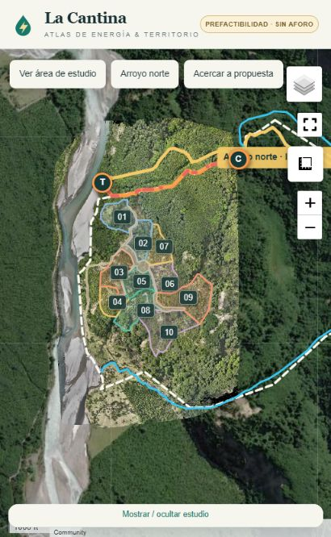

# La Cantina · Prefactibilidad hidroeléctrica

Estudio geoespacial en Python y visor interactivo de alternativas de microhidroelectricidad para el predio La Cantina, Chile.

**[Abrir el visor público](https://la-cantina-hidro.craftysmile14.chatgpt.site)** · [Informe técnico](INFORME_PREFACTIBILIDAD.md) · [Propuesta para Google Earth](outputs/la_cantina_propuesta.kmz) · [Tabla de escenarios](outputs/escenarios.csv)



## Revisión 2 · arroyo norte incluido

La alternativa base **C2-1-1**, en el **arroyo norte (ID 2)**, presenta un salto bruto estimado de **172,91 m**, una aducción de **6,0 m** y una tubería de presión de **720,0 m** en longitud 3D. Se analizan los cauces completos donde existe DTM, sin recortarlos por el deslinde. El trazado evita interiores de lotes, pero **374,0 m de tubería en planta y 6,0 m de aducción quedan fuera del deslinde**, sujetos a validar acceso y tenencia.

Esta revisión sustituye la selección anterior de 13,23 m. **Los arroyos permanentes tienen prioridad 1. Las quebradas no permanentes son de última prioridad**, porque acceder al agua requeriría perforar según la aclaración del propietario. Las quebradas no participan en la selección principal.

| Caudal hipotético | Diámetro interior de cálculo | Potencia eléctrica | Energía anual estimada |
|---:|---:|---:|---:|
| 10 L/s | 5 pulgadas | 10,77 kW | 75.470 kWh |
| 25 L/s | 8 pulgadas | 27,17 kW | 190.425 kWh |
| 50 L/s | 10 pulgadas | 54,19 kW | 379.781 kWh |
| 100 L/s | 12 pulgadas | 107,57 kW | 753.837 kWh |

Cada escenario usa un diámetro interior distinto. La eficiencia global supuesta es 65% y el factor de planta supuesto es 80%. Los diámetros son interiores idealizados, no designaciones nominales comerciales; se dimensionan también para conservar presión en la meseta inicial del arroyo norte. Familia de turbina sugerida: **Pelton / Turgo**. La presión estática preliminar ronda 17 bar; falta revisar presión de trabajo y transitorios.

**Estos resultados no confirman factibilidad constructiva ni económica.** No existen aforos de campo. El DTM cubre aproximadamente el **50,6% del deslinde original**, pero se utiliza también la topografía exterior disponible. Se conservan **los seis cauces y las 512 curvas de nivel completos**, sin recorte predial. El arroyo norte tiene unos 648 m con DTM (42,9% de su longitud total); el arroyo 6 sigue visible sin topografía suficiente para calcular potencia. Deben verificarse cotas, alineación del cauce, niveles de agua, caudal derivable y emplazamiento seguro. Incluir obras exteriores en el estudio no acredita acceso para construirlas.

## Contenido

| Archivo o carpeta | Uso |
|---|---|
| `index.html` | Visor Folium de archivo único con datos, imágenes y descargas incorporados. |
| `INFORME_PREFACTIBILIDAD.md` | Método, resultados, coordenadas, limitaciones y referencias. |
| `analyze.py` | Análisis SIG, selección preliminar, rutas y exportación de resultados. |
| `hydraulics.py` | Pérdidas Hazen–Williams, accesorios, diámetros y generación. |
| `build_viewer.py` + `viewer_panel.html` | Construcción del mapa y panel interactivo. |
| `inspect_data.py` + `explore.py` | Inspección de insumos y cobertura. |
| `verify_outputs.py` | Comprobaciones de geometría, hidráulica y KMZ. |
| `make_report.py` | Generación del informe y paquete local del estudio. |
| `outputs/` | GeoJSON EPSG:4326, perfiles, CSV, KMZ y vistas raster reducidas. |
| KML y SHP en la raíz | Insumos vectoriales del estudio. Conservar los complementos de cada SHP. |

Los TIF originales, DSM/DTM, DXF, PDF, el entorno Python local y los archivos internos del servicio de publicación quedan fuera del repositorio. Las imágenes raster reducidas del visor sí se incluyen y contienen información geográfica del predio. La publicación pública de estos datos fue autorizada por el propietario.

La revisión agrega `outputs/curvas_completas.geojson` sin simplificar, `outputs/inventario_cauces.json`, `outputs/tramos_fuera_deslinde.geojson`, `outputs/escenarios_todas_alternativas.csv` y un KMZ por alternativa. Las curvas del visor conservan toda la extensión original y se simplifican 0,75 m únicamente para su representación web. Los tramos exteriores se marcan en rojo discontinuo.

## Abrir el visor

Descargar el repositorio y abrir `index.html` en un navegador con acceso a Internet, o servirlo localmente:

```bash
python -m http.server 8000
```

Visitar `http://localhost:8000`. Los fondos Esri World Imagery/OpenTopoMap y las bibliotecas JavaScript necesitan Internet. Las ortofotos reducidas y los datos del estudio están incorporados al HTML. Las descargas KMZ y CSV del panel corresponden a la **alternativa seleccionada**. La capa de quebradas está desactivada por defecto y aparece en última prioridad.

## Entorno Python

Python 3.12. Instalar las versiones registradas en la ejecución del estudio:

```bash
python -m venv .venv
```

En Windows PowerShell:

```powershell
.venv/Scripts/python -m pip install -r requirements-lock.txt
```

En Linux/macOS:

```bash
.venv/bin/python -m pip install -r requirements-lock.txt
```

Usar a continuación el Python del entorno creado. Las versiones de `requirements-lock.txt` corresponden al entorno de ejecución original; revisar su disponibilidad y compatibilidad al reconstruir en otra plataforma.

## Reconstrucción con resultados existentes

Las cachés web de los ortomosaicos están en `outputs/`, por lo que se puede reconstruir el visor a partir de los resultados publicados sin descargar los TIF originales:

```bash
python build_viewer.py
python verify_outputs.py
python make_report.py
```

El constructor actualiza `index.html` y una copia en `sites/la-cantina-hidro/dist/`, carpeta local excluida de Git. Las verificaciones comprueban que el arroyo norte entra en la evaluación, que las curvas y cauces no estén recortados, las prioridades, las longitudes exteriores, los perfiles y los cálculos de todas las alternativas. `verify_outputs.py` genera `outputs/viewer-scripts.js`; si Node.js está instalado, comprobar también su sintaxis:

```bash
node --check outputs/viewer-scripts.js
```

## Recalcular desde los insumos originales

Para repetir el análisis completo deben obtenerse del propietario y colocarse en la raíz estos raster originales, que no se distribuyen aquí:

- `LA_CANTINA_dtm.tif`
- `LA_CANTINA_dsm.tif`
- `LA_CANTINA_GSD10_EXTENT.tif`
- `LA_CANTINA_transparent_mosaic_group1.tif`

El cálculo de cotas utiliza el DTM; el DSM se conserva como insumo de superficie. Los vectores KML/SHP originales y sus complementos están incluidos.

```bash
python inspect_data.py
python analyze.py
python build_viewer.py
python verify_outputs.py
python make_report.py
```

Las distancias se calculan en **EPSG:32718 (UTM 18S)**; los vectores del visor se exportan a **EPSG:4326**. Las imágenes web se reproyectan a Web Mercator para su representación en Leaflet. Los archivos originales no se modifican.

## Fuentes y atribución

- Levantamiento y geometrías prediales proporcionados por el propietario.
- [EPA · EPANET](https://www.epa.gov/water-research/epanet), para pérdidas distribuidas y locales.
- [DOE · Types of Hydropower Turbines](https://www.energy.gov/cmei/water/types-hydropower-turbines), como referencia para familias de turbinas.
- Fondos cartográficos Esri y OpenTopoMap, con atribución en el visor. La publicación del código y los resultados no modifica las licencias de esas fuentes.
